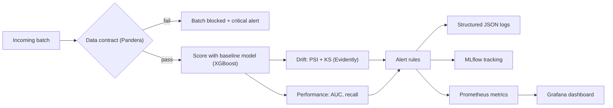
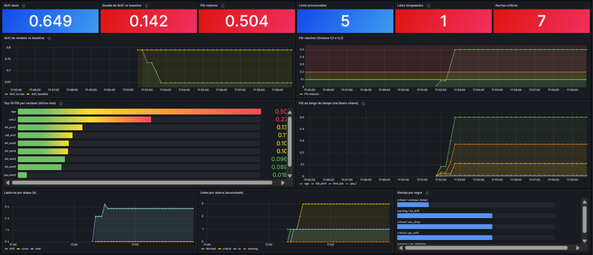
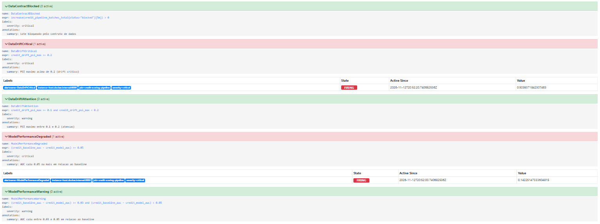
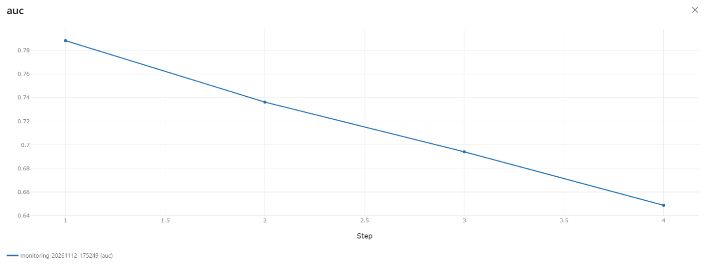
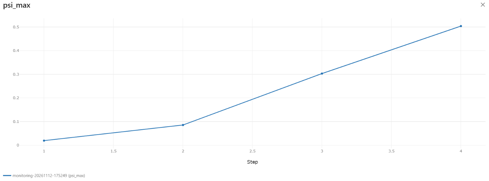
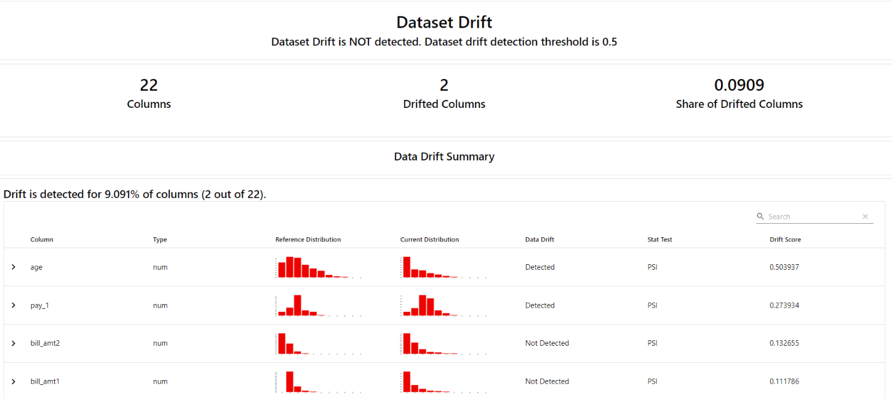
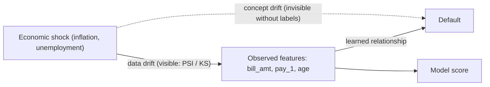

# Credit Scoring Observability


> Reliability and governance layer for a credit-scoring model in production: **data contracts**, **drift simulation and detection**, **observability** (logs, MLflow, Prometheus, Grafana), **causal analysis** of performance degradation and **LGPD-oriented governance**.

Project for the **FIAP MLET Tech Challenge, Phase 4** (Continuous Observability, Drift Detection, Data Quality and Governance in Production). Built by [Gabriel Furtado](https://github.com/GFurts).

## The problem

A lender's credit-scoring model keeps running while the economy changes (inflation, new customer profiles). Nothing crashes, but decisions silently get worse. This repository builds the layer that notices:

1. **Block bad data** before it reaches the model (data contract).
2. **Detect drift** between the training data and what arrives in production (PSI and KS tests).
3. **Watch the model**, not only the servers: performance, drift and pipeline health, with alerts.
4. **Explain the cause** of the degradation with a controlled experiment.
5. **Document governance**: personal data, legal basis, fairness and retention (LGPD).

## Architecture



## Requirements map

| Tech Challenge requirement | Where |
|---|---|
| Data validation pipeline (data contracts) | `contracts.py`, `make_bad_batch.py`, `tests/test_contract.py`, `tests/test_contracts.py` |
| Drift simulation and statistical detection | `simulate_drift.py`, `drift.py` |
| Dashboards / HTML reports | `reports/drift_period_*_psi.html`, `reports/drift_period_4_ks.html`, Grafana, MLflow |
| Logs and metrics centralized | `pipeline.py` (JSON logs), MLflow, Prometheus (`metrics.py`) |
| Governance documentation | [Governance and LGPD](#governance-and-lgpd) |
| Causal analysis | `causal_analysis.py`, [Causal analysis](#causal-analysis) |
| Automated tests and CI | `tests/`, `.github/workflows/ci.yml` (GitHub Actions) |
| Semantic commit history | Conventional Commits (`feat:`, `fix:`, `test:`, `docs:`, `chore:`) |

## Repository layout

```
src/credit_scoring_observability/
  data.py            load the raw UCI file, standardize columns, profile the data
  prep.py            clean category codes, split reference (20,000) / production base (10,000)
  contracts.py       Pandera data contract
  make_bad_batch.py  batch with deliberate errors to prove the contract blocks it
  train.py           baseline XGBoost (aborts if the contract fails)
  simulate_drift.py  4 production periods with growing data drift + concept drift
  drift.py           Evidently reports with PSI and KS
  pipeline.py        batch-by-batch pipeline: contract, scoring, drift, alerts, logs, MLflow
  metrics.py         Prometheus metrics exporter
  causal_analysis.py interventional analysis of the performance drop
  fairness_audit.py  group-level bias audit
  proxy_audit.py     can the excluded attribute be predicted from the model features?
monitoring/          Prometheus config, alert rules, Grafana provisioning and dashboard
reports/             generated evidence (HTML reports, JSON/Markdown summaries)
docs/img/            screenshots used in this README
tests/               unit tests: alert rules, data contract, drift simulator
.github/workflows/   CI (runs the tests on every push and pull request)
```

## Quickstart

Requires Python 3.12 and [Poetry](https://python-poetry.org/). Docker is only needed for Prometheus and Grafana.

```bash
poetry install

# 1. Get the data (not versioned here): download "default of credit card clients.xls"
#    from the UCI repository and save it as data/raw/default of credit card clients.xls

# 2. Prepare data, train the baseline
poetry run python -m credit_scoring_observability.data
poetry run python -m credit_scoring_observability.prep
poetry run python -m credit_scoring_observability.contracts
poetry run python -m credit_scoring_observability.train

# 3. Simulate drift and detect it
poetry run python -m credit_scoring_observability.make_bad_batch
poetry run python -m credit_scoring_observability.simulate_drift
poetry run python -m credit_scoring_observability.drift

# 4. Analyses
poetry run python -m credit_scoring_observability.causal_analysis
poetry run python -m credit_scoring_observability.fairness_audit
poetry run python -m credit_scoring_observability.proxy_audit

# 5. Observability
docker compose up -d                                            # Prometheus :9090, Grafana :3000 (admin/admin)
poetry run python -m credit_scoring_observability.pipeline --serve --delay 15
poetry run mlflow ui --backend-store-uri sqlite:///mlflow.db    # MLflow :5000

poetry run pytest -q                                            # data-dependent tests are skipped if steps 1-3 were not run
```

## Data

[Default of Credit Card Clients](https://archive.ics.uci.edu/dataset/350/default+of+credit+card+clients) (UCI Machine Learning Repository), 30,000 customers from Taiwan (2005), binary target "default next month" (22.1% positives). Licensed under Creative Commons Attribution 4.0 International (CC BY 4.0).

> Yeh, I. (2009). Default of Credit Card Clients [Dataset]. UCI Machine Learning Repository. https://doi.org/10.24432/C55S3H
>
> Introductory paper: Yeh, I. C., & Lien, C. H. (2009). The comparisons of data mining techniques for the predictive accuracy of probability of default of credit card clients. *Expert Systems with Applications*, 36(2), 2473-2480.

The 30,000 rows are split once: **20,000 reference** rows (what the model sees) and **10,000 production base** rows (where drift is injected). The raw file is git-ignored.

## Stage 1: data contract and baseline

The contract (`contracts.py`, Pandera) validates every batch before it reaches the model:

| Rule | Why |
|---|---|
| `id` unique, positive, not null | detects duplicated records (checked on `id`, not on whole rows: 35 identical-profile rows in the data are different customers) |
| `limit_bal` > 0, integer, not null | impossible or missing credit limit |
| `age` between 18 and 100 | adults only, no impossible values |
| `sex` in {1, 2}, `education` in {1..4}, `marriage` in {1..3} | valid categories (undocumented codes 0/5/6 and 0 are grouped as "other" in `prep.py`) |
| `pay_1`..`pay_6` in [-2, 9] | valid repayment status |
| `pay_amt1`..`pay_amt6` >= 0 | payments cannot be negative (bills can, when a customer overpays) |
| `default` in {0, 1}; no unknown or missing columns | schema integrity |

The contract checks **validity**, not **similarity to training data**: a batch with higher incomes is valid, and detecting that is the job of the drift layer.

**Proof that it blocks bad data.** `make_bad_batch.py` corrupts 500 rows (negative and under-age `age`, null `limit_bal`, invalid `sex` and `education`, negative `pay_amt1`, duplicated `id`). The contract reports **81 violations across 7 checks**, exits with code `1`, and `train.py` refuses to train on data that fails the contract.

**Baseline model** (XGBoost, 22 features, `id` and `sex` excluded): ROC-AUC **0.791**, average precision 0.568. At the 0.5 threshold: precision 0.70 and recall 0.38 for defaulters (the class is imbalanced).

## Stage 2: drift simulation and detection

`simulate_drift.py` splits the production base into four batches of 2,500 customers, as four consecutive months of an economic squeeze. Period 1 is a control (no drift); intensity grows after that.

| Cause | Type | What changes |
|---|---|---|
| Inflation | data drift | `bill_amt1..6` grow +10% / +25% / +45% |
| More late payments | data drift | share of customers delaying `pay_1` grows |
| New customer profile | data drift | customers get younger (`age`) |
| Mechanism change | **concept drift** | good payers (`pay_1 <= 0`) default more often, with the same features |

All periods still **pass the data contract**: drift changes distributions, not validity.

**Effect on the model** (labels assumed available):

| Period | Default rate | AUC | Recall | Late payers (`pay_1 >= 1`) | Mean age |
|---|---|---|---|---|---|
| 1 (control) | 22.0% | 0.788 | 0.344 | 21.6% | 36.0 |
| 2 | 25.1% | 0.736 | 0.333 | 30.4% | 33.4 |
| 3 | 27.7% | 0.694 | 0.312 | 36.6% | 31.5 |
| 4 | 31.5% | 0.649 | 0.267 | 44.3% | 30.2 |

**Drift detection** (`drift.py`, Evidently) compares each period against the reference with two tests. **PSI** measures *how much* a distribution moved (< 0.1 stable, 0.1 to 0.2 attention, >= 0.2 drift). **KS** tests *whether* distributions differ (p < 0.05).

| Feature | Period 1 | Period 2 | Period 3 | Period 4 |
|---|---|---|---|---|
| `age` PSI | 0.010 | 0.086 | **0.303** | **0.504** |
| `pay_1` PSI | 0.003 | 0.036 | 0.122 | **0.274** |
| `bill_amt1` PSI | 0.011 | 0.025 | 0.025 | 0.112 |
| `limit_bal` PSI (untouched) | 0.007 | 0.007 | 0.010 | 0.011 |
| Features flagged by PSI | none | none | `age` | `age`, `pay_1` |
| Features flagged by KS (of 22) | 1 | 8 | 8 | 8 |

- Features we did not alter (`limit_bal`, `pay_amt*`, `pay_2`..`pay_6`) stay quiet: the detector points at the right culprits.
- PSI is conservative: inflation on long-tailed bills only reaches the *attention* band (0.09 to 0.13 in period 4). KS is more sensitive and catches the bills from period 2, at the cost of false positives (1 of 22 in the control period, about what 22 tests at 5% produce by chance).
- Concept drift **does not show up in feature drift tests**; only performance reveals it.

Reports: `reports/drift_period_{1..4}_psi.html`, `reports/drift_period_4_ks.html`, `reports/drift_summary.json`.

## Stage 3: observability

`pipeline.py` replays the incoming batches like a real operation: first the corrupted batch, then periods 1 to 4. For each batch it validates the contract, scores, measures drift and performance, evaluates alert rules, and emits structured logs, MLflow metrics and Prometheus metrics.

**Alert rules**

| Level | Condition |
|---|---|
| Critical | contract failed, **or** any PSI >= 0.2, **or** AUC dropped >= 0.05 vs baseline |
| Warning | any PSI in [0.1, 0.2), **or** KS flags >= 25% of features, **or** AUC dropped >= 0.03 vs baseline |

Replay result: the corrupted batch is **blocked**, period 1 is **ok**, and periods 2 to 4 are **critical** (7 critical alerts in total). The AUC alert fires **one batch before** the PSI alert: performance monitoring catches the degradation first.

**Health metrics**

| Metric (Prometheus / MLflow) | Meaning |
|---|---|
| `credit_pipeline_batches_total{status}` | batches processed by status (ok, warning, critical, blocked) |
| `credit_data_contract_ok` | 1 if the last batch passed the contract, 0 if blocked |
| `credit_last_batch_rows` | data volume of the last batch |
| `credit_model_auc`, `credit_model_recall`, `credit_model_default_rate` | model quality on the last batch |
| `credit_baseline_auc` | AUC at training time (reference for the drop) |
| `credit_drift_psi{feature}`, `credit_drift_psi_max` | PSI per feature and the worst one |
| `credit_drift_ks_share` | share of features flagged by KS |
| `credit_pipeline_stage_seconds{stage}` | latency of scoring, drift and total (scoring about 3 ms; drift about 1.8 s for 2,500 rows) |
| `credit_alerts_total{severity,rule}` | alerts fired |

- **Logs:** `logs/pipeline.log`, one JSON event per line (batch received, contract passed or failed with violations, scored, drift computed, alert, batch done). Logs contain counts and metrics, never row-level data.
- **MLflow:** one run per replay, metrics logged per batch (step 0 is the corrupted batch, steps 1 to 4 the periods), with the log, the model and the HTML reports as artifacts.
- **Prometheus + Grafana:** `docker compose up -d` starts both. Prometheus scrapes the pipeline every 5 s and evaluates `monitoring/alerts.yml`; Grafana provisions the dashboard "Credit Scoring: Observabilidade" automatically (AUC vs baseline, PSI over time, top-10 PSI, latency, batches by status, alerts by rule).

## Screenshots

**Grafana dashboard** after replaying the four production periods: AUC falls from 0.791 to 0.649 while the maximum PSI climbs to 0.504.



**Prometheus alerts** firing for critical drift (`DataDriftCritical`) and model degradation (`ModelPerformanceDegraded`).



| MLflow: AUC per period | MLflow: max PSI per period |
|---|---|
|  |  |

**Evidently drift report (period 4).** The report-level verdict ("Dataset Drift is NOT detected") follows Evidently's default rule of 50% of columns drifting. This project alerts per feature instead (PSI >= 0.2), and `age` (0.50) and `pay_1` (0.27) both exceed it.



## Causal analysis

Degradation, drift and alerts rise together over the four periods, so observation alone cannot say what caused the drop. Because drift is simulated, we can **intervene**: switch on one cause at a time, at the period-4 intensity, and compare against a control with no causes (30 random seeds each, on the 10,000-row production base).



| Scenario | AUC | ΔAUC vs control | Recall | Default rate |
|---|---|---|---|---|
| control (no cause) | 0.779 | - | 0.357 | 22.1% |
| inflation only | 0.777 | -0.002 | 0.373 | 22.1% |
| more late payments only | 0.772 | -0.007 | 0.381 | 22.1% |
| younger customers only | 0.778 | -0.001 | 0.354 | 22.1% |
| **data drift only (all three)** | 0.768 | **-0.011** | 0.389 | 22.1% |
| **concept drift only** | 0.651 | **-0.128** | 0.232 | 34.2% |
| everything (period 4) | 0.653 | -0.125 | 0.283 | 30.6% |

**Finding:** in this simulation almost the entire AUC drop comes from **concept drift** (-0.128), while all input shifts together cost about -0.011. Features that cross PSI thresholds (`age`, `pay_1`) barely hurt the model; the real damage is a change in the relationship between profile and default, which the model cannot see. **A high PSI is a reason to investigate, not proof of a performance loss.**

**Limitations of this analysis** (read before quoting the numbers):
- The proportions depend on the intensity we chose for each cause (concept drift rate of 0.18 in period 4). The lesson is qualitative, not a real-world percentage.
- The "late payments" scenario changes `pay_1` without regenerating the label, so it embeds a little concept drift; the pure covariate-shift effect is at most that small.
- The small positive interaction (+0.014) is partly a simulation artifact: label flips only apply to customers with `pay_1 <= 0` after delays are applied, so delayed customers stop being eligible.
- In real life one cannot intervene like this; a real analysis would need explicit causal assumptions (the graph above), labeled data and sensitivity checks.

## Governance and LGPD

> This section documents design decisions for a Brazilian lender and refers to Lei 13.709/2018 (LGPD). It is a technical document, not legal advice; a production deployment needs review by the data protection officer and legal counsel.

**Scope.** The dataset used here is public and contains no direct identifiers (no name, tax ID or address). The description below states how the system treats personal data and how it would be operated in production.

### Data inventory

| Fields | Nature | Treatment |
|---|---|---|
| `id` | pseudonymous identifier (personal data if it can be linked to a person) | used only for uniqueness checks; **excluded from model features**; never written to logs |
| `limit_bal`, `bill_amt*`, `pay_amt*`, `pay_*` | financial behavior of an identifiable person | personal data; model inputs; kept only in the data store, not in logs or dashboards |
| `age`, `education`, `marriage` | demographic | personal data; model inputs; flagged as **discrimination-risk attributes** and audited |
| `sex` | demographic | **excluded from model features** (data minimization and non-discrimination); retained only for the bias audit |
| `default` | outcome label | personal data; used for training and performance monitoring |

None of these fields is "sensitive personal data" in the sense of Art. 5, II of the LGPD, but sex, age and marital status carry a real risk of discriminatory use in credit decisions, so they are treated as protected attributes.

### Legal basis

- **Primary basis:** Art. 7, X, "protection of credit" (*proteção do crédito*), which allows processing for credit protection without requiring consent.
- **Alternative:** Art. 7, IX (legitimate interest), which would require a documented balancing test.
- Consent (Art. 7, I) is not relied on for the credit decision itself. Credit-specific regulation applies on top of the LGPD and must be confirmed by legal counsel.

### Principles applied (Art. 6)

- **Purpose and necessity:** data are used only for credit-risk scoring and its monitoring; `id` and `sex` are not given to the model.
- **Transparency:** this document, the alert rules and the model metrics are public inside the repository.
- **Security:** no row-level data in logs, MLflow or Prometheus; only aggregates. Grafana ships with local demo credentials (`admin/admin`) that **must be replaced** outside a demo.
- **Non-discrimination:** see the bias audit below.
- **Accountability:** every replay records parameters, metrics, thresholds, model and reports in MLflow, and the Git history records every change.

### Automated decisions (Art. 20)

Data subjects have the right to request a review of decisions based solely on automated processing that affect their interests, including decisions that define their credit profile (Art. 20). The controller must provide clear and adequate information about the criteria and procedures used, subject to commercial and industrial secrecy (Art. 20, §1).

As an additional governance safeguard, this project **recommends** making human review available for adverse credit decisions. This is a project recommendation, not a statutory requirement.

What follows from this for operation:

1. **Legal duty:** be able to answer a review request and to provide clear information about the criteria and procedures behind a score.
2. **Recommended safeguard:** route adverse decisions to a human reviewer.
3. **Recommended capability:** feature-level reason codes per decision (**not implemented yet**: see limitations).
4. **Traceability:** model versions and thresholds are recorded in MLflow, so a past decision can be reconstructed.

### Bias audit (`fairness_audit.py`)

Evaluated on the same held-out test set as training (4,000 customers, threshold 0.5). "Flag" means the model predicts default (the adverse outcome). TPR is the share of real defaulters flagged; FPR the share of good payers flagged by mistake.

| Attribute | Group | n | Actual default | Flag rate | TPR | FPR | AUC |
|---|---|---|---|---|---|---|---|
| sex | female | 2,439 | 21.1% | 11.7% | 0.383 | 0.046 | 0.790 |
| sex | male | 1,561 | 23.8% | 12.7% | 0.380 | 0.048 | 0.791 |
| age | < 30 | 1,294 | 23.5% | 13.4% | 0.421 | 0.046 | 0.799 |
| age | 30-44 | 2,017 | 20.2% | 10.0% | 0.322 | 0.044 | 0.772 |
| age | 45+ | 689 | 25.3% | 15.5% | 0.454 | 0.054 | 0.821 |
| marital status | married | 1,828 | 23.1% | 12.9% | 0.383 | 0.052 | 0.787 |
| marital status | single | 2,111 | 21.3% | 11.4% | 0.378 | 0.042 | 0.794 |
| marital status | other | 61 | 19.7% | 13.1% | 0.500 | 0.041 | 0.781 |

| Attribute | Flag-rate ratio (min/max) | TPR gap | FPR gap | AUC gap |
|---|---|---|---|---|
| sex | 0.921 | 0.003 | 0.002 | 0.001 |
| age | 0.645 | 0.132 | 0.011 | 0.049 |
| marital status | 0.867 | 0.122 | 0.011 | 0.013 |

**Reading:**
- **Sex:** the observed group-level metrics are similar (flag-rate ratio 0.92, TPR gap 0.003, FPR gap 0.002). However, excluding `sex` from the model features does not remove the information it carries: the proxy test below shows that the model features still contain some signal about `sex`.
- **Age:** the flag-rate ratio (0.65) is below the common 0.8 rule of thumb (a US employment convention, not a Brazilian legal test), but the **FPR gap is only 0.011**: good payers are wrongly flagged at about 4% to 5% in every age band. The difference comes from real default-rate differences (20.2% to 25.3%) and from how well the model detects defaulters in each band (TPR 32% to 45%).
- **Marital status "other"** has 61 customers; its figures are noise.
- No confidence intervals were computed.

**Proxy test (`proxy_audit.py`).** To check whether removing `sex` removes its information, a model is trained to predict `sex` from the 22 model features (5-fold cross-validation).

| Test | AUC |
|---|---|
| Predict `sex` from the model features | 0.649 ± 0.007 |
| Control: shuffled labels (should be ~0.5) | 0.498 ± 0.006 |

Strongest features for this prediction: `limit_bal` (0.098), `pay_3` (0.096), `age` (0.094), `education` (0.075), `marriage` (0.075).

The control sits at chance level, so the signal is real: the model features carry a **moderate** amount of information about `sex`. Even so, the audit above shows near-identical outcomes by sex, so in this model that information did not translate into different treatment. This is evidence at a single threshold (0.5) and without confidence intervals; it is not proof of non-discrimination.

**Mitigation decisions:** `sex` and `id` are excluded; the audit is repeatable (`python -m credit_scoring_observability.fairness_audit`); `age` and `marriage` are kept in the model **on purpose and with this risk documented**. Recommended next steps: legal review of using age and marital status, an ablation retraining without them to measure the cost (the demographic features `age`, `education` and `marriage` are among the strongest carriers of the `sex` signal), and adding the group-level gaps above to the monitoring dashboard (age also drifts: customers get younger in the simulation).

### Retention plan (proposed policy, to be validated by legal)

| Data | Proposed retention | Rationale |
|---|---|---|
| Raw personal data (identifiers, contact) | not stored in this system | out of scope; minimization |
| Model inputs and predictions, pseudonymized by `id` | 24 months rolling | needed to review contested decisions (Art. 20) and to monitor drift |
| Aggregated monitoring metrics (no personal data) | no expiry | not personal data when properly aggregated |
| Model artifacts, thresholds and run history | as long as decisions made with them can be contested | reproducibility and auditability |
| Training snapshots | until the model version is retired | retraining and audit |

At the end of processing, personal data are **deleted**, except where Art. 16 allows keeping them (for example a legal or regulatory obligation, or exclusive controller use after anonymization). Anonymized data stop being personal data only while the anonymization cannot be reasonably reversed (Art. 12). Data subjects keep their Art. 18 rights (access, correction, deletion where applicable, among others), handled through the lender's data protection officer.

A **data protection impact assessment** (*relatório de impacto*, Art. 38) is recommended before production.

## Tests and CI

`poetry run pytest -q` runs unit tests for the parts that make decisions:

| Test file | What it protects |
|---|---|
| `tests/test_alerts.py` | alert rules: PSI and AUC thresholds (including the exact boundary), KS share, one alert per drifting feature, no alert when AUC improves |
| `tests/test_contract.py` | the strict data contract on a synthetic batch: valid batch passes; negative age, invalid `sex`, duplicated `id` and unexpected columns are blocked |
| `tests/test_simulate_drift.py` | each simulated cause moves only what it should (bills, late payments, age); zero drift changes nothing; same seed gives the same result |
| `tests/test_contracts.py` | contract against the real reference data and the corrupted batch (skipped automatically when the local data files are absent) |

GitHub Actions (`.github/workflows/ci.yml`) installs the project with Poetry and runs the suite on every push and pull request. The data files are git-ignored, so in CI the tests that need them are skipped and the synthetic-data tests carry the coverage.

## Operating playbook

| Signal | Meaning | Action |
|---|---|---|
| Contract failure | upstream data problem | block the batch, alert the data owner; do not score |
| PSI 0.1 to 0.2 or KS alert | early drift signal | investigate the shifted features; **do not retrain automatically** |
| PSI >= 0.2 | strong input shift | investigate; check performance on labeled data |
| AUC drop >= 0.03 / >= 0.05 | real quality loss (the causal analysis shows concept drift dominates) | open a retraining review; compare challenger vs champion before replacing the model |

Labels (actual defaults) arrive late in real life, so performance alerts lag; track leading indicators such as the share of late payers in the meantime.

## Limitations

- Drift is **simulated** on a 2005 Taiwanese dataset, not on real Brazilian production data. The study demonstrates the method, not a real-world magnitude.
- Labels are assumed to be available when each batch is evaluated.
- No feature-level explanations (reason codes) per decision yet.
- Alerts are visible in Prometheus and Grafana but not routed to a notification channel (no Alertmanager).
- Fairness audit without confidence intervals; small groups are unreliable.
- The model features carry a moderate signal about `sex` (AUC 0.65 in the proxy test). Outcome parity held at threshold 0.5, but it was not tested across thresholds.
- Latency figures come from a local machine.
- Grafana demo credentials are for local use only.

## Author

Gabriel Furtado: [GitHub](https://github.com/GFurts) · [LinkedIn](https://linkedin.com/in/gabriel-furtado30) · [Portfolio](https://gabriel-furtado.vercel.app)
