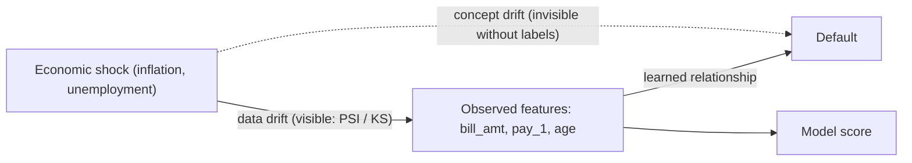

# Credit Scoring Observability

Camada de sustentação para um modelo de credit scoring: contratos de dados,
simulação e detecção de drift, observabilidade e governança (LGPD).
Projeto do Tech Challenge Fase 4 (FIAP MLET).

## Dados
Dataset *Default of Credit Card Clients* (UCI Machine Learning Repository),
de Yeh & Lien (2009). O arquivo bruto **não** é versionado neste repositório.
Baixe-o no site da UCI e salve como `data/raw/default of credit card clients.xls`.

## Como rodar
    poetry install
    poetry run python -m credit_scoring_observability.data
    poetry run python -m credit_scoring_observability.prep
    poetry run python -m credit_scoring_observability.contracts
    poetry run python -m credit_scoring_observability.train

## Status
- [x] Etapa 1: contrato de dados e baseline
- [ ] Etapa 2: simulação e detecção de drift
- [ ] Etapa 3: observabilidade
- [ ] Etapa 4: governança e LGPD

### Análise causal — Data Drift e Concept Drift

O diagrama abaixo ilustra uma hipótese de como mudanças
econômicas podem afetar as características dos clientes
e o risco de inadimplência.

A seta tracejada representa um possível efeito de fatores
econômicos não capturados pelas variáveis de entrada.

O Data Drift é monitorado pelas mudanças nas distribuições
das variáveis. Já o Concept Drift requer evidências de
mudanças na relação entre as características e o resultado
real, utilizando dados rotulados e análises adicionais.

Este grafo é uma hipótese explicativa, não uma identificação
causal comprovada.
